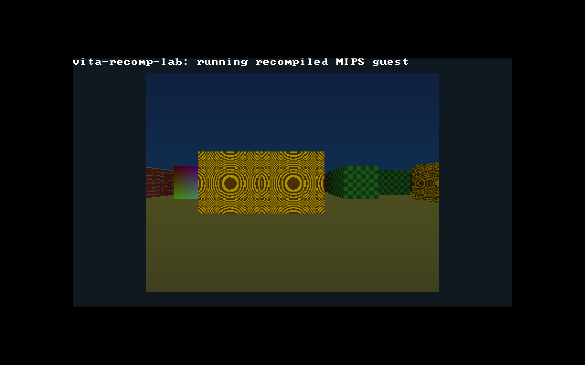

# vita-recomp-lab

Laboratório de **recompilação estática para ports nativos no PS Vita**.

Um executável de outra arquitetura (hoje: **MIPS32r2 + FPU**, a família do
PS1/N64/PS2) é convertido em **C portável**, compilado para **ARMv7-A (Cortex-A9,
Thumb-2, NEON, hard-float)** e empacotado como **homebrew `.vpk`**, sem emulação
em tempo de execução.



## O que já está demonstrado

| Etapa | Evidência |
|---|---|
| Toolchain Vita construída do código-fonte (vita-toolchain, 496 stubs de NIDs, headers) | `scripts/bootstrap-toolchain.sh` |
| Recompilador MIPS → C (`recomp/mipsrecomp`) | 60 opcodes distintos traduzidos nos testes |
| Fidelidade: QEMU (referência) × x86-64 × ARMv7 | 25/25 casos C em -O0..-Os, **bit a bit** |
| Fuzzing de instruções (estado arquitetural completo) | 650+ programas aleatórios, 0 divergências |
| Desempenho (raycaster, 600 quadros, x86-64) | 0,33 s nativo × 0,97 s QEMU JIT (**2,9×**) |
| Homebrew Vita: `eboot.bin` (SELF) + `param.sfo` + `.vpk` | `scripts/build-vita-port.sh` |
| Execução no **Vita3K** (compilado do fonte, headless) | renderiza e responde a entrada (`docs/vita3k_input.png`) |
| Evidência REA | `docs/evidence/` (VPK e binário recompilado x86-64) |

**PBR** (normal map, ORM e luz GGX com as luzes do próprio jogo) no renderizador Vulkan do port de PC:
**[docs/pbr.md](docs/pbr.md)**.

Leia **[docs/viabilidade.md](docs/viabilidade.md)** para as conclusões, os
limites e o caminho para um jogo real.

## Uso rápido

```bash
# 1. guest MIPS (qualquer ELF MIPS32 LE estático; aqui um de exemplo)
scripts/build-guest.sh build/raycast.elf tests/demos/raycast.c

# 2. recompilar e empacotar para o Vita
scripts/build-vita-port.sh build/raycast.elf raycast VRLB00002
#    -> build/vita/raycast/raycast.vpk

# 3. validar
python3 tests/run_diff.py                 # QEMU × x86-64 × ARMv7
python3 tests/fuzz/run_fuzz.py --arm      # fuzzing diferencial
python3 tools/lockstep.py <guest.elf>     # 1ª instrução divergente
scripts/run-vita3k.sh "" out 25 35        # (com V3K_ARGS="-r TITLEID")
```

## Estrutura

```
recomp/mipsrecomp/   recompilador (ELF, decodificador, análise, emissor C)
runtime/             contrato do código gerado + runtime portável
runtime/host/        camada de plataforma Linux (testes)
runtime/vita/        crt0 freestanding, console de framebuffer, plataforma Vita
guest/               libc mínima do guest, crt0, linker script
tests/               testes C, demo (raycaster), fuzzer
tools/lockstep.py    localizador de divergência contra o log single-step do QEMU
scripts/             build do guest, build/empacotamento Vita, Vita3K headless
docs/                viabilidade, arquitetura, fidelidade, evidências, PBR (docs/pbr.md)
```

O QEMU **não** faz parte do port: ele é apenas o oráculo de referência dos testes.
O mesmo C gerado serve para outros alvos (Android, Windows…) trocando apenas a
camada `rc_platform_*`.
